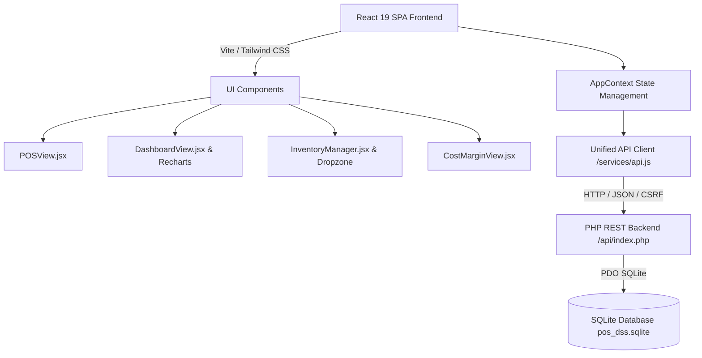

# POS DSS — Smart Point of Sale & Decision Support System

[](https://react.dev/)
[](https://tailwindcss.com/)
[](https://recharts.org/)
[](https://lucide.dev/)
[](https://www.php.net/)
[](https://www.sqlite.org/)

A modern, responsive **Point of Sale (POS)** and **Decision Support System (DSS)** designed for Small and Medium Enterprises (SMEs) such as retail stores, mini groceries, cafes, and specialty shops. Built with a high-performance **React + Tailwind CSS** architecture on top of a resilient **PHP/SQLite** API backend.

---

## 🚀 Live Demo & Quick Walkthrough

### 1-Click Demo Accounts

Sign in with any of the built-in demo profiles directly from the login screen:

| Role | Username | Password | Access Scope |
|---|---|---|---|
| 👑 **Administrator** | `admin` | `admin123` | Full Access: POS, Inventory, Margins, Sales History, User Management & System Settings |
| 🛒 **Cashier** | `cashier` | `cashier123` | POS Checkout & Sale Processing only |
| 📊 **Business Owner** | `owner` | `owner123` | Executive Dashboard, Analytics, Inventory, Margins & DSS Reports |

---


### 1. 🛍️ Point of Sale Component (`POSView.jsx`)
- **Category-First Drilldown**:
  - Interactive category cards with product counters and modern icons (`Beverages`, `Snacks`, `Grocery`, `Cafe`, `Medicine`).
  - Clicking any category smoothly transitions into the nested Product Grid with an interactive breadcrumb trail (`Categories / Beverages`).
- **Fixed Aspect-Ratio Image Containers**:
  - Square container (`aspect-square object-contain p-2 bg-slate-50 dark:bg-zinc-800/50 rounded-xl`).
  - Keeps bottle caps, beverage cans, and packaged goods fully visible without cropping or stretching.
- **Interactive Cart Drawer with Dual Increments**:
  - **Whole Unit Buttons (`+1` / `-1`)**: Solid primary buttons for whole-unit adjustments.
  - **Precision Buttons (`+0.25` / `-0.25`)**: Compact pill buttons for fractional weights, volumes, and bulk merchandise.
  - Real-time Subtotal, Tax, and Grand Total auto-calculations.
- **Tender & Thermal Receipt Modal**:
  - Cash tendered input with quick tender presets (`Exact`, `$50`, `$100`, `$500`).
  - Real-time Change Due calculator (`Payment - Total Due`).
  - Printable receipt layout with invoice number, itemized totals, and cashier info.

---

### 2. 📦 Inventory & Drag-and-Drop Image Uploader (`InventoryManager.jsx`)
- **Grouped Category Accordions**:
  - Products organized under expandable/collapsible Category accordions.
  - Displays product counts, low stock alerts, and category summaries.
  - Search filter across items, SKUs, and stock states (`All`, `Low Stock`, `Out of Stock`).
- **Visual File Dropzone Modal (`react-dropzone` style)**:
  - Drag local image files directly from **Windows Explorer** or click to browse.
  - Immediate visual image preview before committing.
  - Supports JPG, PNG, WebP, and GIF up to 5MB.
- **Inline Stock Adjustments**:
  - Quick stock restock or audit deductions (`+5`, `+10`, `+25`, `-5`) with logged audit notes.

---

### 3. 📊 Main Dashboard & DSS Visualizations (`DashboardView.jsx`)
- **Consolidated Analytics KPIs**:
  - Total Gross Revenue, Daily Realized Profit, Low Stock Items count, and Total Sales Count.
- **Interactive Recharts Visualizations**:
  - **Sales & Revenue Trend**: Dual-axis Area/Line chart of Gross Revenue vs. Net Profit with time filters (**Today**, **7 Days**, **30 Days**).
  - **Inventory Stock Status**: Horizontal Bar chart color-coded by inventory health:
    - 🟢 **Green (`#10b981`)**: Healthy stock level.
    - 🟡 **Yellow (`#f59e0b`)**: Warning threshold (within 1.5x minimum).
    - 🔴 **Red (`#ef4444`)**: Low stock / Needs reorder.
- **DSS Decision Support Modules**:
  - **Top-Selling Ranking**: Top products by revenue and units sold.
  - **Reorder Recommendations**: Urgent items requiring restocking with one-click restock jump.

---

### 4. 📈 Cost & Profit Margin Analysis (`CostMarginView.jsx`)
- **Dedicated Margin Grid**:
  - Interactive table displaying Selling Price alongside **Inline Cost Price Input Controls**.
- **Calculated Margin Indicators**:
  - **Unit Margin Badge**: `$(Selling Price - Cost Price)` color-coded in green (profit) or red (loss), with margin percentage.
  - **Daily Accumulated Profit per item**: Real-time formula: `(Selling Price - Cost Price) × Units Sold Today`.
  - **Inventory Valuation Summary**: Total Potential Inventory Margin, Stock Cost Valuation, and Expected Retail Revenue.
  - Individual inline save or batch **Save All Cost Changes** button.

---

### 5. 🧾 Sales History & Transaction Audit (`SalesHistoryView.jsx`)
- Complete transaction log with date/time, cashier name, invoice number, subtotal, tax, total, and profit.
- One-click reprint receipt dialog.
- Void transaction functionality with required audit reason (automatically updates DSS revenue metrics).

---

### 6. ⚙️ Settings & User Management (`SettingsView.jsx`)
- Configurable sales tax percentage.
- Role-based user creation and password resets (Admin, Cashier, Owner).
- SQLite database status.

---

## 🛠️ Technology Architecture



---

## 💻 How to Run Locally on Windows

### Prerequisites
- **PHP 8.1+** with `pdo_sqlite` enabled
- **Node.js 18+** and **npm**

### Step 1: Start the PHP Backend Server
In PowerShell, navigate to the `POS_DSS_Project_Plan` folder and start the server:
```powershell
cd "c:\Users\NeoN\Documents\List for repositories\POS_DSS_Project_Plan\POS_DSS_Project_Plan"
php -S 127.0.0.1:8000
```

### Step 2: Open the Application
Open your browser and navigate to:
```text
http://127.0.0.1:8000/
```
The root URL redirects directly to the compiled modern React application in `web/`.

### Step 3 (Optional): Run Vite Development Server
If you are developing or modifying the React components with Hot Module Replacement (HMR):
```powershell
cd "c:\Users\NeoN\Documents\List for repositories\POS_DSS_Project_Plan\POS_DSS_Project_Plan\frontend"
npm run dev
```
Open **`http://localhost:5173/`** (Vite proxies all `/api` requests to the PHP server at port `8000`).

To recompile the production bundle into `web/`:
```powershell
npm run build
```

---

## 👤 Author & License
Developed as a Decision Support & Point of Sale System for SMEs.

